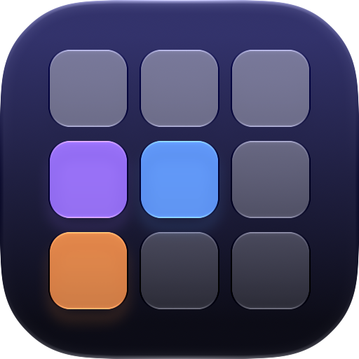
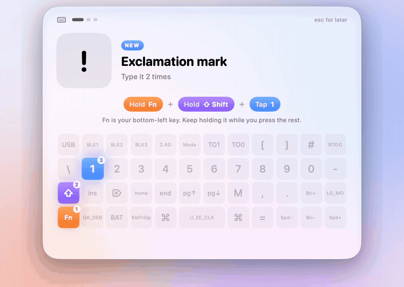
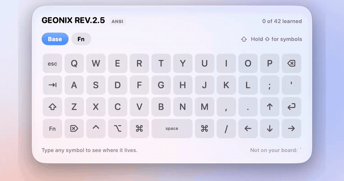

<div align="center">

<picture>
  <source media="(prefers-color-scheme: dark)" srcset="docs/icon-dark.png">
  
</picture>

# Keyboard Trainer

**Learn your keyboard's layers, a few keys at a time.**

A tiny Mac app for small keyboards. Every so often it floats in over whatever you're doing,<br>
asks you to type a couple of symbols, and shows you exactly which keys to press.

<br>

<picture>
  <source media="(prefers-color-scheme: dark)" srcset="docs/drill-dark.gif">
  
</picture>

</div>

<br>

## Why

40% keyboards are lovely until you need a `#`. The symbols live on hidden layers, and it's hard to remember where. Keyboard Trainer reads the layers straight off your keyboard and teaches them to you bit by bit, like Anki. The ones you get wrong come back sooner.

## What it does

- **It has no main window.** It lives in the menu bar, and a card appears every 25 minutes. You can pick anything from 10 to 60.
- **It waits for a pause in your typing**, so it never eats half a sentence.
- **It stays out of the way** while your screen is shared, mirrored or locked, or while you're away. It also hides itself from screenshots and screen recordings.
- **It teaches two new symbols at a time.** You type each one twice with the keys lit up, and it tests you on them later.
- **It ends each drill with a short phrase** that uses symbols you know, like `ali@home.uk` or `(a + b) * 2`.
- **It understands your setup.** It reads your real keymap over [Vial](https://get.vial.today), and it asks macOS what your input source types for each key. So British-PC, US and other layouts all come out right.

<br>

<div align="center">

<picture>
  <source media="(prefers-color-scheme: dark)" srcset="docs/map-dark.gif">
  
</picture>

<sub>Press <kbd>⌃</kbd> <kbd>⌥</kbd> <kbd>K</kbd> to see your whole layout. Type any symbol to see where it lives.</sub>

</div>

<br>

## Shortcuts

| Keys | What it does |
| --- | --- |
| <kbd>⌃</kbd> <kbd>⌥</kbd> <kbd>D</kbd> | Start a drill now |
| <kbd>⌃</kbd> <kbd>⌥</kbd> <kbd>K</kbd> | Show your layers |
| <kbd>esc</kbd> | Put the drill off for 10 minutes |

## Install

You need macOS 14 or later and Xcode.

```sh
git clone https://github.com/alii/keyboard-trainer
cd keyboard-trainer
./scripts/bundle.sh
open ~/Applications/"Keyboard Trainer.app"
```

Plug your keyboard in with a USB cable once, so the app can read its layers. Most wireless keyboards only share them over a cable. After that, Bluetooth is fine. The app reads the layers again every time you plug in.

It works with any keyboard running Vial firmware.

## How it works

| File | What's in it |
| --- | --- |
| `VialReader.swift` | Talks to the keyboard over raw HID and downloads its layout and keymap |
| `Recipes.swift` | Finds the easiest way to type each symbol: which layer, whether you need Shift or Option, and which key |
| `Deck.swift` | The spaced repetition, and what to teach next |
| `ScreenGuard.swift` | Decides whether now is a good moment to pop up |
| `AppIcon.icon` | The Liquid Glass icon. Open it in Icon Composer |

Your progress and keymap are saved in `~/Library/Application Support/Keyboard Trainer`.

To record the demos in this README, run the app with `--demo drill` or `--demo map`. Set `KT_ALLOW_CAPTURE=1` so the card shows up in recordings.
